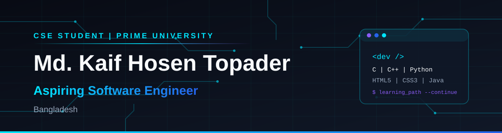
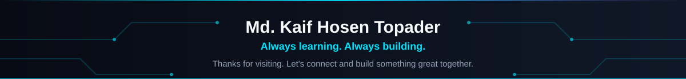

 

<h2><b>Md. Kaif Hosen Topader</b></h2>

---

## 01 · About Me

I am **Md. Kaif Hosen Topader**, a Computer Science and Engineering student at **Prime University**, Bangladesh. I am driven by a genuine love for programming and a steady curiosity about how software works under the hood.

My learning journey is built on strong fundamentals. I am currently working with **C** and **C++**, strengthening my problem-solving through **Data Structures and Algorithms**, and expanding into **Python** and **Java**. I also build for the web with **HTML** and **CSS**.

My goal is to grow into a skilled software engineer who builds reliable, well-designed systems and keeps learning with every project.

---

## 02 · Education

<table>
  <tr>
    <td>

**Prime University**
Bachelor of Science in Computer Science and Engineering (CSE)
Dhaka, Bangladesh

</td>
  </tr>
</table>

---

## 03 · Tech Stack

**Languages**

  

**Web Technologies**

---

## 04 · Currently Learning

<table>
  <tr>
    <td align="center" width="200">
      
       <b>Data Structures &amp; Algorithms</b>
       Sharpening problem-solving skills
    </td>
    <td align="center" width="200">
      
       <b>Advanced C++</b>
       Deepening language mastery
    </td>
    <td align="center" width="200">
      
       <b>Python</b>
       Building a broader toolkit
    </td>
  </tr>
  <tr>
    <td align="center" width="200">
      
       <b>Java</b>
       Exploring object-oriented design
    </td>
    <td align="center" width="200">
      
       <b>Software Development</b>
       Learning how real systems come together
    </td>
  </tr>
</table>

---

## 05 · Featured Projects

<table>
  <tr>
    <td align="center" width="320" valign="top">
       
      
      <h3>01 · Personal Portfolio Website</h3>
      
[Add short project description]

      
Tech: [Add technology tags]

      

        Repository: [Add GitHub link] 
        Demo: [Add demo link]
      

       
    </td>
    <td align="center" width="320" valign="top">
       
      
      <h3>02 · Smart Entry Security System</h3>
      
[Add short project description]

      
Tech: [Add technology tags]

      

        Repository: [Add GitHub link] 
        Demo: [Add demo link]
      

       
    </td>
    <td align="center" width="320" valign="top">
       
      
      <h3>03 · Smart Face Recognition Attendance System</h3>
      
[Add short project description]

      
Tech: [Add technology tags]

      

        Repository: [Add GitHub link] 
        Demo: [Add demo link]
      

       
    </td>
  </tr>
</table>

---

## 06 · GitHub Statistics

  

---

## 07 · Contribution Graph

<picture>
  <source media="(prefers-color-scheme: dark)" srcset="https://raw.githubusercontent.com/md-kaif-hosen/md-kaif-hosen/output/github-contribution-grid-snake-dark.svg"/>
  
</picture>

---

## 08 · Connect With Me

<!-- Email: uncomment the line below and replace the address if you want to publish it.

-->

---

